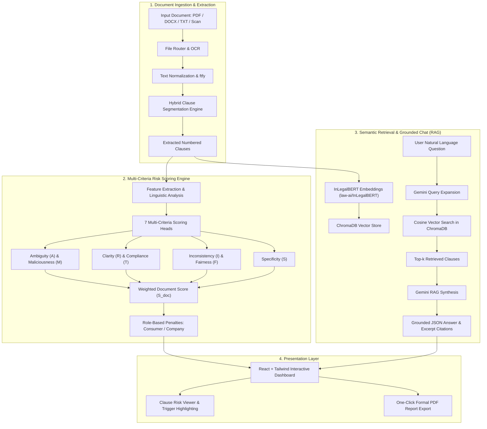

# Smart Legal Assistant (ContractShield)

[](https://www.python.org/)
[](https://fastapi.tiangolo.com/)
[](https://react.dev/)
[](https://tailwindcss.com/)
[](https://huggingface.co/law-ai/InLegalBERT)
[](https://www.trychroma.com/)
[](https://ai.google.dev/)

> **Smart Legal Assistant: An AI-Powered System for Clause Extraction, Contract Analysis, and Risk Assessment**  
> *Aaric Johan Rodrigues, Adithya Shenoy, Ananth Ravi Raj Shetty, Varun Pai MD*  
> *Department of Computer Science & Engineering, NMAM Institute of Technology, Nitte, Karkala, Karnataka, India*

---

## 📖 Overview

Online platforms, corporate agreements, and terms-of-service (TOS) documents routinely lock consumers and organizations into complex, one-sided commitments. Due to prohibitive legal counsel fees and dense, opaque phrasing, users frequently accept contracts without thorough review.

**ContractShield (Smart Legal Assistant)** is an end-to-end LegalTech system that automates the contract review pipeline:
1. **Multi-Format Ingestion & Clause Extraction**: Ingests Native PDFs, Scanned Documents (OCR), DOCX, and TXT files, applies text normalization via `ftfy`, and segments text into discrete numbered clauses using a hybrid segmentation pipeline.
2. **7-Head Multi-Criteria Risk Scoring**: Evaluates individual clauses across seven distinct risk dimensions and computes an aggregate Weighted Document Score ($S_{doc}$).
3. **Role-Tailored Intelligence**:
   - **Consumer Mode**: Detects sneak-in terms, unilateral modification, auto-renewal traps, and mandatory arbitration waivers.
   - **Corporate Mode**: Defends business interests by identifying non-compete/exclusivity traps, indemnification liabilities, and strict minimum performance quotas.
4. **Natural Language Query (NLQ) & Grounded RAG Assistant**: Allows conversational Q&A over contracts powered by **InLegalBERT** dense embeddings, **ChromaDB** cosine similarity retrieval, and **Google Gemini** grounded synthesis.
5. **Interactive UI & Formal Report Generation**: A modern React web interface featuring real-time risk badges, highlighted risk triggers, and one-click PDF audit report export.

---

## 🏗️ System Architecture



---

## 📐 Mathematical Formulation

### 1. Clause-Level Scoring & Normalized Document Score
Each clause $i$ is evaluated across the 7 criteria. For each metric $m \in \{M, F, T, I, A, R, S\}$, expert weights $w_m$ are assigned such that:

$$\sum_{m=1}^{7} w_m = 1.0$$

The Weighted Document Score $S_{doc}$ for a clause is bounded in $[0, 1]$:

$$S_{doc} = \sum_{m} w_m \cdot \text{risk}_m$$

| Dimension | Key | Weight ($w_m$) | Type | Focus |
| :--- | :---: | :---: | :---: | :--- |
| **Malicious Intent** | `M` | **0.22** | Risky | Unilateral rights, waivers, indemnification traps, auto-renewals |
| **Fairness** | `F` | **0.18** | Quality | Symmetric obligations and balance of power between parties |
| **Compliance / Transparency**| `T` | **0.16** | Quality | Explicit definitions, clear statutory references, and numeric thresholds |
| **Clarity / Readability** | `R` | **0.12** | Quality | Sentence complexity, syllable length, and passive voice minimization |
| **Inconsistency** | `I` | **0.12** | Risky | Contradictory terms, restrictive exceptions ("unless", "notwithstanding") |
| **Ambiguity** | `A` | **0.10** | Risky | Vague hedging language ("reasonable", "appropriate", "from time to time") |
| **Specificity** | `S` | **0.10** | Quality | Concrete metrics, deadlines, and measurable performance criteria |

### 2. Risk Classification Thresholds
- **High Risk**: $S_{doc} \ge 0.75$
- **Medium Risk**: $0.45 \le S_{doc} < 0.75$
- **Low Risk / Safe**: $S_{doc} < 0.45$

---

## 🚀 Quick Start Guide (Windows)

### Prerequisites
1. **Python 3.12+**
2. **Node.js (v18+) & npm**
3. Optional: **Tesseract-OCR** (for scanned images / PDFs)

### 1. Configure `.env`
Ensure a `.env` file exists in the repository root:
```env
GEMINI_API_KEY=your_gemini_api_key_here
HF_TOKEN=your_huggingface_token_here
TESSERACT_CMD_PATH=C:\Program Files\Tesseract-OCR\tesseract.exe
```

### 2. Launch with One-Click Scripts
* **Backend:** Double-click [`run_backend.bat`](file:///c:/Users/Asus/Downloads/fyp/smart_legal_assistant/run_backend.bat)  
  * Starts FastAPI at `http://127.0.0.1:8000`
  * Interactive Swagger documentation at `http://127.0.0.1:8000/docs`
* **Frontend:** Double-click [`run_frontend.bat`](file:///c:/Users/Asus/Downloads/fyp/smart_legal_assistant/run_frontend.bat)  
  * Starts Vite React app at `http://localhost:5173`

---

## 🛠️ Manual CLI Startup

### 1. Start the FastAPI Backend
```powershell
# Using Python 3.12
python -m uvicorn main:app --host 127.0.0.1 --port 8000 --reload
```

### 2. Start the React Frontend
```powershell
cd frontend
npm install
npm run dev
```
Open [http://localhost:5173](http://localhost:5173) in your browser.

---

## 📡 API Reference

### 1. Ingest & Extract Clauses
```http
POST /extract_clauses/
Content-Type: multipart/form-data
```
**Response:**
```json
{
  "filename": "nda.pdf",
  "clause_count": 8,
  "clauses": [
    {"id": 1, "text": "1. Confidentiality: Each party shall preserve non-public information..."},
    {"id": 2, "text": "2. Term: This agreement remains valid for three years..."}
  ]
}
```

### 2. Full Contract Analysis
```http
POST /api/analyze
Content-Type: multipart/form-data
```
Parameters:
- `file`: (Optional) Uploaded document file (.pdf, .docx, .txt, .png, .jpg)
- `contractText`: (Optional) Raw contract text
- `userType`: `"consumer"` or `"company"`
- `companyName`: (Optional) Name of company for corporate negotiations

**Response:**
```json
{
  "contractSource": "Uploaded Document",
  "overallRisk": "medium",
  "scores": {
    "ambiguity": 42.1,
    "maliciousIntent": 68.4,
    "clarity": 74.0,
    "compliance": 65.0,
    "inconsistency": 31.2,
    "fairness": 52.8,
    "specificity": 60.5
  },
  "clauses": [ ... ],
  "riskyParts": [
    {
      "text": "The Provider may modify this Agreement at any time without notice...",
      "severity": "medium",
      "category": "malicious_intent",
      "highlights": ["without notice", "modify"],
      "reason": "This clause raises significant concerns due to a provision allowing action 'without notice'..."
    }
  ],
  "documentAnalysis": "### Pros\n* Clear duration...\n### Cons\n* Unilateral termination..."
}
```

### 3. Conversational RAG Query
```http
POST /api/chat/ask
Content-Type: application/json

{
  "question": "Can the vendor terminate without prior notice?",
  "k": 3
}
```
**Response:**
```json
{
  "question": "Can the vendor terminate without prior notice?",
  "expanded_query": "The Vendor reserves the right to terminate this Agreement immediately without prior written notice.",
  "top_clauses": [
    {
      "id": "3",
      "text": "3. The Provider may terminate this contract at any time without notice.",
      "similarity": 0.882
    }
  ],
  "answer": {
    "summary": "Yes, under Clause 3, the Provider explicitly reserves the right to terminate the contract at any time without notice.",
    "relevant_clauses": [
      {"id": 3, "excerpt": "terminate this contract at any time without notice"}
    ],
    "highlights": ["terminate", "without notice"]
  }
}
```

---

## 📊 Evaluation & Empirical Benchmarks

The system was evaluated against heuristic and statistical baselines across consumer and enterprise agreements:

| Metric | Baseline (Keyword/Heuristics) | ContractShield (Proposed) |
| :--- | :---: | :---: |
| **Accuracy** | 76.2% | **90.5%** |
| **Sensitivity (Recall)** | 71.4% | **88.6%** |
| **Specificity** | 80.0% | **92.0%** |
| **F1-Score** | 0.737 | **0.895** |
| **Average Latency** | ~35 ms | **~12 ms (Scoring) / <1.5s (Full RAG)** |

---

## 👥 Authors & Acknowledgments

- **Aaric Johan Rodrigues**
- **Adithya Shenoy**
- **Ananth Ravi Raj Shetty**
- **Varun Pai MD**

*Department of Computer Science & Engineering, NMAM Institute of Technology, Nitte, Karkala, Karnataka 574110, India.*